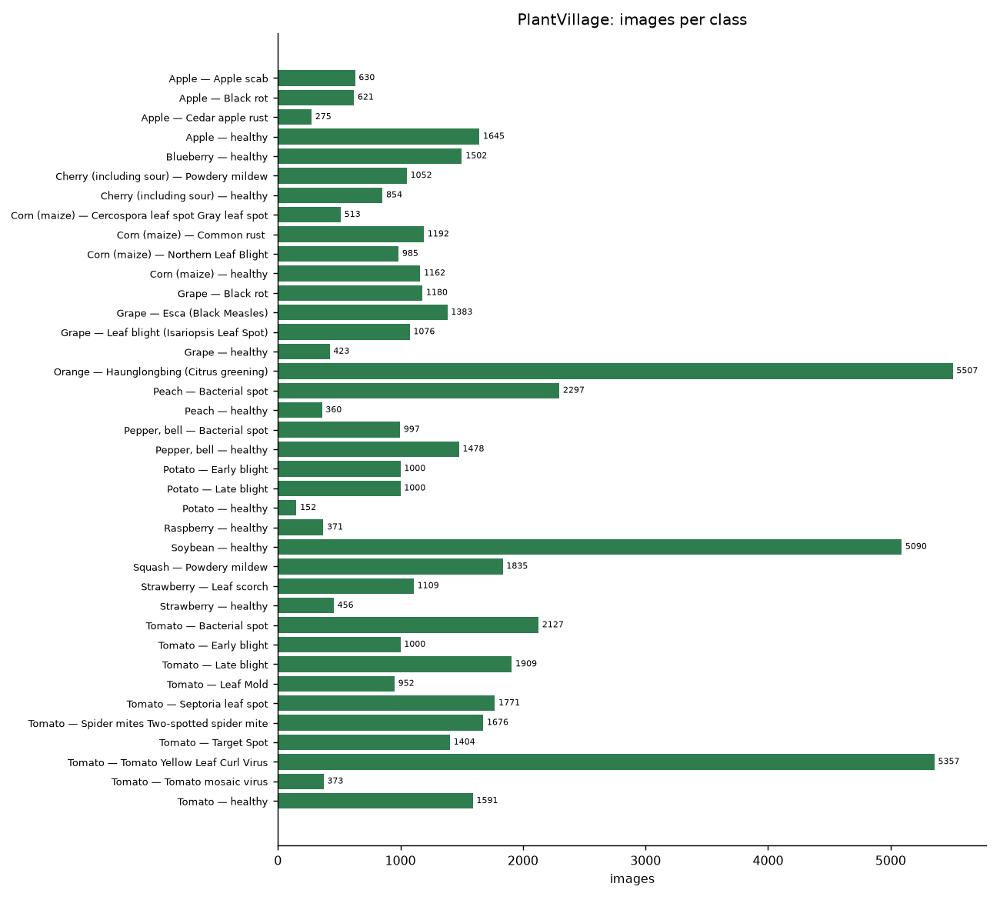
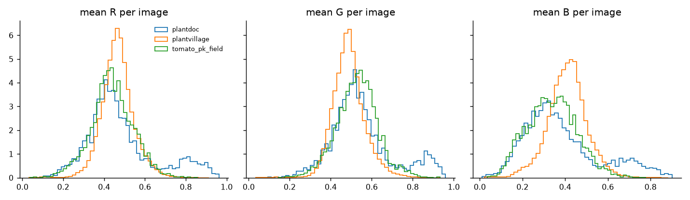
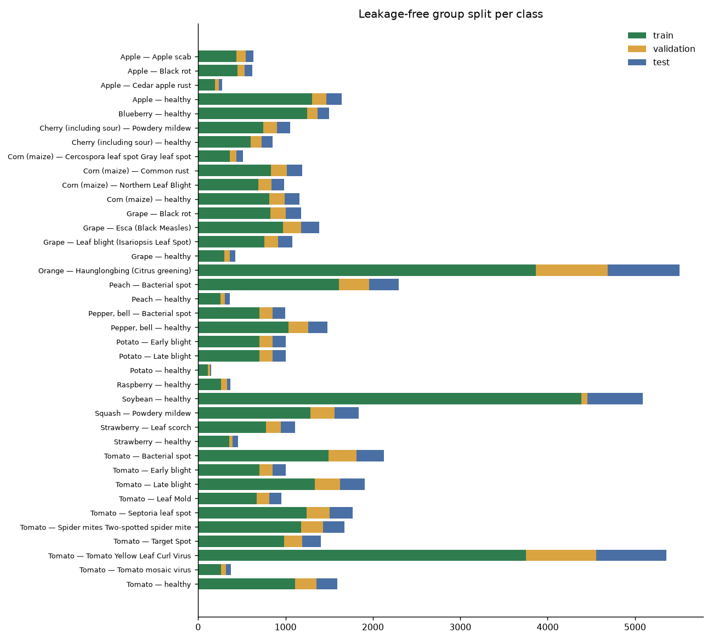
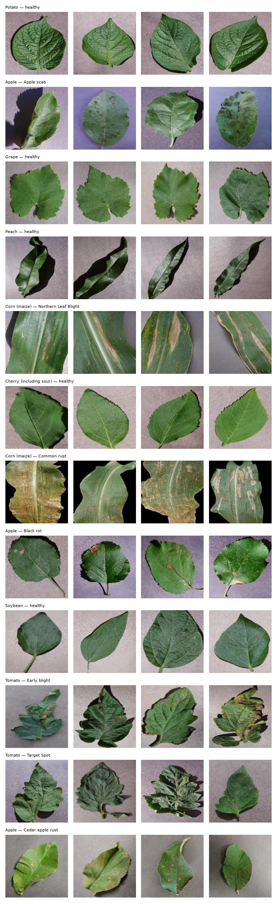
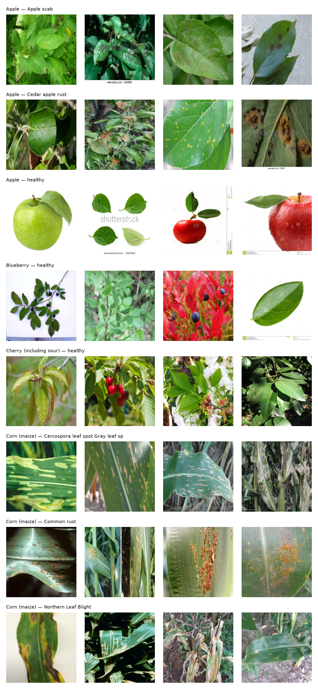
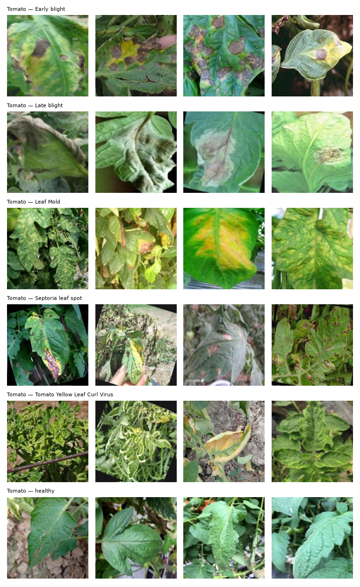

# Dataset Report

All numbers in this report were produced by `ml/preprocessing/build_dataset.py` (seed 42) and are stored in
`ml/datasets/metadata/dataset_statistics.json`. Raw data are never modified; split manifests in
`ml/datasets/processed/*/manifest.csv` reference raw files by relative path (no image copies, because the
development machine had under 10 GB of free disk).

## 1. Sources and acquisition

| Dataset | Role | Source | Licence | Images verified | Classes |
|---|---|---|---|---:|---:|
| PlantVillage (color) | train / validation / internal test | [spMohanty/PlantVillage-Dataset](https://github.com/spMohanty/PlantVillage-Dataset) @ `7f7ecc7` (`raw/color`, sparse git checkout) | CC BY-SA 3.0 (repo `README_HF.md`) | 54,305 | 38 |
| PlantDoc (classification) | external validation / domain-train / external test | [pratikkayal/PlantDoc-Dataset](https://github.com/pratikkayal/PlantDoc-Dataset) @ `5467f60` | CC BY 4.0 (`LICENSE.txt`) | 2,572 (2,336 train + 236 test) | 28 |
| Tomato Leaf Disease, Pakistan | independent external test | [Mendeley Data 3mbnb82mxd](https://data.mendeley.com/datasets/3mbnb82mxd) `Tomato_Leaf_Dataset.zip` (sha256 `66380c16…`) | CC BY 4.0 | 7,200 | 6 |

**Kaggle.** Kaggle was searched first, but the Kaggle CLI cannot even list datasets without an API token
(`~/.kaggle/kaggle.json` absent) and Kaggle web downloads require login. The authors' own repositories were
used instead (more authoritative than Kaggle mirrors). Plant Pathology 2020 (apple, field images) is hosted
only as a Kaggle competition and was therefore **not** acquired; it is optional (see README).

Provenance for each dataset (URL, commit/sha256, licence, date, extraction path, counts, processing status)
is recorded in `ml/datasets/metadata/dataset_manifest.json`. `scripts/verify_datasets.py` re-checks the files.

## 2. Integrity checks

| Check | Result |
|---|---|
| Corrupt / unreadable images (PIL `verify` + full decode) | **0** of 64,077 |
| PlantVillage image size | all 54,305 are 256×256 RGB JPEG |
| PlantDoc image size | median 800×667, min width 115 px, max width 6,000 px |
| Tomato-PK image size | all 256×256 (resized by the dataset authors) |
| Exact duplicates (MD5), all sources | 182 groups / 381 images |
| PlantVillage images matched to the official leaf-identity map | 41,111 (7,257 physical leaves have >1 photo) |
| Within-class near-duplicate pairs (pHash Hamming ≤ 4) | 1,165 |
| Leakage groups after union (leaf id ∪ MD5 ∪ pHash) | **19,988** |
| PlantDoc ↔ PlantVillage near-duplicates | 1 image (removed from external sets) |
| Tomato-PK ↔ PlantVillage near-duplicates / exact | 0 / 0 |
| PlantDoc test images duplicating PlantDoc train | 14 (removed from external test) |

### Label verification
* All 38 PlantVillage folder names were parsed into `crop___condition`; `class_mapping.json` holds index, display crop, condition and healthy flag.
* Every one of the 28 PlantDoc classes and 6 Tomato-PK classes was mapped by hand onto a PlantVillage class
  (`class_mapping.json → external_label_maps`). Mapping notes: PlantDoc "Bell_pepper leaf spot" → PlantVillage
  *Bacterial spot* (PlantDoc's own paper aligns these); PlantDoc "Corn leaf blight" → *Northern Leaf Blight*.
  No incompatible label was merged — classes without a PlantVillage counterpart would have been dropped (none were).
* Visual inspection of sample grids (`ml/artifacts/eda/samples_*.png`) confirmed labels look plausible.
  The Tomato-PK images show rotation-with-black-corner patterns, i.e. the published 1,200 images/class include
  **augmented copies** of fewer originals. This does not leak (never trained on) but makes its samples correlated,
  so its effective sample size is smaller than 7,200.

## 3. Class balance

PlantVillage is strongly imbalanced: largest class *Orange — Haunglongbing* 5,507 images, smallest *Potato — healthy*
152 images (ratio **36.2×**). Training therefore uses inverse-√frequency class weights and model selection uses
**macro**-F1.



## 4. Colour statistics (domain shift)

Mean per-image RGB on PlantVillage: R 0.466, G 0.489, B 0.410 (std of per-image means 0.165 / 0.137 / 0.182).
The per-image colour histograms of PlantDoc and Tomato-PK differ markedly from PlantVillage's uniform lab
backgrounds — an early warning that lab accuracy will not transfer to field photos. Normalisation uses ImageNet
statistics because all backbones are ImageNet-pretrained.



## 5. Leakage-free splits

Whole leakage groups were assigned to train / validation / test with a per-class greedy fill to ≈70/15/15
(seed 42). An assertion in the script guarantees that no group appears in more than one split.

PlantDoc's training release is split by group (stratified, 80/20) into:
* **domain_train** (1,872) — used *only* in the explicitly labelled domain-adaptation experiment;
* **external_validation** (463) — used only for temperature fitting, threshold selection and model selection.

PlantDoc's test release (222 after de-duplication) and all 7,200 Tomato-PK images form the untouched **external_test**.

| Class | Train | Validation | Test | PlantDoc ext-val | PlantDoc domain-train | External test |
|---|---:|---:|---:|---:|---:|---:|
| Apple — Apple scab | 441 | 101 | 88 | 16 | 67 | 10 |
| Apple — Black rot | 449 | 81 | 91 | 0 | 0 | 0 |
| Apple — Cedar apple rust | 196 | 40 | 39 | 16 | 62 | 10 |
| Apple — healthy | 1305 | 163 | 177 | 16 | 66 | 9 |
| Blueberry — healthy | 1246 | 120 | 136 | 21 | 83 | 10 |
| Cherry (including sour) — Powdery mildew | 745 | 157 | 150 | 0 | 0 | 0 |
| Cherry (including sour) — healthy | 603 | 123 | 128 | 10 | 37 | 10 |
| Corn (maize) — Cercospora leaf spot Gray leaf spot | 360 | 77 | 76 | 13 | 51 | 3 |
| Corn (maize) — Common rust  | 835 | 179 | 178 | 21 | 85 | 10 |
| Corn (maize) — Northern Leaf Blight | 690 | 148 | 147 | 36 | 143 | 10 |
| Corn (maize) — healthy | 814 | 174 | 174 | 0 | 0 | 0 |
| Grape — Black rot | 828 | 176 | 176 | 11 | 45 | 8 |
| Grape — Esca (Black Measles) | 972 | 207 | 204 | 0 | 0 | 0 |
| Grape — Leaf blight (Isariopsis Leaf Spot) | 756 | 160 | 160 | 0 | 0 | 0 |
| Grape — healthy | 297 | 63 | 63 | 11 | 46 | 12 |
| Orange — Haunglongbing (Citrus greening) | 3865 | 820 | 822 | 0 | 0 | 0 |
| Peach — Bacterial spot | 1612 | 343 | 342 | 0 | 0 | 0 |
| Peach — healthy | 254 | 52 | 54 | 20 | 82 | 9 |
| Pepper, bell — Bacterial spot | 699 | 151 | 147 | 13 | 49 | 9 |
| Pepper, bell — healthy | 1036 | 224 | 218 | 11 | 42 | 8 |
| Potato — Early blight | 700 | 152 | 148 | 21 | 87 | 6 |
| Potato — Late blight | 700 | 152 | 148 | 18 | 79 | 5 |
| Potato — healthy | 112 | 24 | 16 | 0 | 0 | 0 |
| Raspberry — healthy | 265 | 68 | 38 | 23 | 89 | 7 |
| Soybean — healthy | 4389 | 68 | 633 | 12 | 45 | 8 |
| Squash — Powdery mildew | 1285 | 275 | 275 | 24 | 100 | 6 |
| Strawberry — Leaf scorch | 780 | 167 | 162 | 0 | 0 | 0 |
| Strawberry — healthy | 359 | 37 | 60 | 18 | 70 | 8 |
| Tomato — Bacterial spot | 1491 | 320 | 316 | 20 | 81 | 7 |
| Tomato — Early blight | 700 | 152 | 148 | 15 | 64 | 1209 |
| Tomato — Late blight | 1337 | 289 | 283 | 19 | 81 | 1209 |
| Tomato — Leaf Mold | 668 | 144 | 140 | 17 | 68 | 1206 |
| Tomato — Septoria leaf spot | 1240 | 266 | 265 | 26 | 114 | 1210 |
| Tomato — Spider mites Two-spotted spider mite | 1176 | 252 | 248 | 1 | 1 | 0 |
| Tomato — Target Spot | 983 | 211 | 210 | 0 | 0 | 0 |
| Tomato — Tomato Yellow Leaf Curl Virus | 3752 | 804 | 801 | 14 | 56 | 1205 |
| Tomato — Tomato mosaic virus | 262 | 56 | 55 | 9 | 35 | 10 |
| Tomato — healthy | 1107 | 249 | 235 | 11 | 44 | 1208 |
| **Total** | **39,309** | **7,245** | **7,751** | **463** | **1,872** | **7,422** |




## 6. Preprocessing and augmentation (reproducible)

* **Train:** RandomResizedCrop(224, scale 0.55–1.0, ratio 0.8–1.25), horizontal + vertical flip, RandomRotation(30°, p=0.5),
  ColorJitter(brightness 0.3, contrast 0.3, saturation 0.25, **hue 0.02**), GaussianBlur(p=0.2), ImageNet normalisation.
  Hue jitter is kept tiny because yellowing/necrosis colour is diagnostic; leaves have no canonical orientation, so
  vertical flips and rotations are label-preserving.
* **Eval / serving:** resize short side to size/0.875, centre crop, ImageNet normalisation. The backend re-implements
  this without torchvision and `backend/tests/test_preprocessing.py` asserts numerical equality (atol 1e-5).

## 7. Samples

| PlantVillage | PlantDoc | Tomato-PK |
|---|---|---|
|  |  |  |

## 8. Reproduce

```bash
python scripts/verify_datasets.py          # checks counts
python -I ml/preprocessing/build_dataset.py # ~1 min on an M1 (6 worker processes)
```
