# Model Evaluation Report

_Generated by `ml/evaluation/write_report.py` from `ml/artifacts/evaluation/` on 2026-11-05T17:51:42+00:00. Every number below comes from saved model predictions on held-out data._

## 1. Summary

* **Deployed model:** EfficientNet-B0 (`effnet_b0_224`), 4.1 M parameters, 224 px input, 16 MB checkpoint, 133 ms mean CPU latency (batch 1).
* **Selection rule:** argmax mean(validation macro-F1, external-validation macro-F1); ties within 0.005 broken by CPU latency. Test and external-test sets were not used for selection.
* **Internal (PlantVillage test, n=7,751):** accuracy 99.56%, macro-F1 99.49%, macro precision 99.46%, macro recall 99.52%, weighted F1 99.56%.
* **External — PlantDoc test (n=222):** accuracy 31.1%, macro-F1 28.3%, crop accuracy 58.1%, top-3 53.6%.
* **External — Tomato field, Pakistan (n=7,200):** accuracy 26.5%, macro-F1 24.2%, top-3 44.0%.
* **Internal → external gap:** 68.5% absolute accuracy drop on PlantDoc and 73.1% on the tomato field set. Lab accuracy must not be read as field accuracy.

## 2. Model comparison

Validation columns drove model selection; test columns were computed once afterwards.

| Model | Trained on | Params | Epochs (best) | Train min | Val macro-F1 | Ext-val macro-F1 | PlantVillage test (internal) acc / macro-F1 | PlantDoc test (field) acc / macro-F1 | Tomato field, Pakistan (field) acc / macro-F1 | CPU ms | MPS ms | Size MB |
|---|---|---:|---:|---:|---:|---:|---:|---:|---:|---:|---:|---:|
| **EfficientNet-B0** (deployed) | PlantVillage train | 4.1 M | 5 (5) | 103 | 99.63% | 16.8% | 99.6% / 99.5% | 31.1% / 28.3% | 26.5% / 24.2% | 133 | 9 | 16 |

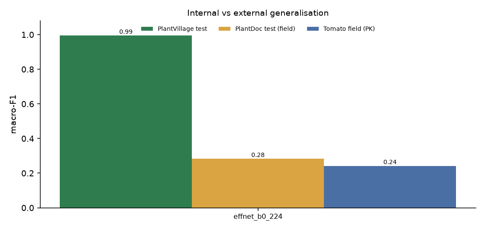

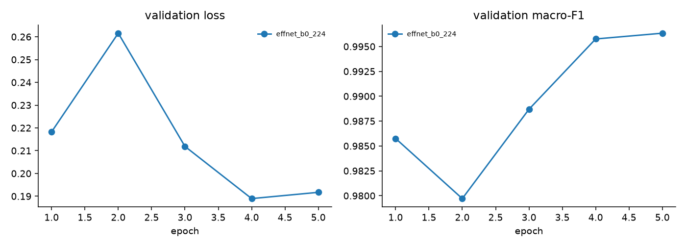

### Full metric table per model and set

| Model | Set | n | Acc | Macro P | Macro R | Macro F1 | Weighted F1 | Crop acc | Top-3 | ECE raw → cal |
|---|---|---:|---:|---:|---:|---:|---:|---:|---:|---|
| EfficientNet-B0 | validation | 7,245 | 99.72% | 99.58% | 99.70% | 99.63% | 99.72% | 100.0% | 100.0% | 0.166 → 0.205 |
| EfficientNet-B0 | external_validation | 463 | 20.09% | 27.23% | 18.90% | 16.76% | 19.20% | 47.7% | 39.3% | 0.265 → 0.235 |
| EfficientNet-B0 | test | 7,751 | 99.56% | 99.46% | 99.52% | 99.49% | 99.56% | 100.0% | 100.0% | 0.172 → 0.211 |
| EfficientNet-B0 | external_test_plantdoc | 222 | 31.08% | 35.25% | 31.41% | 28.33% | 28.84% | 58.1% | 53.6% | 0.196 → 0.171 |
| EfficientNet-B0 | external_test_tomato_pk_field | 7,200 | 26.50% | 48.59% | 26.50% | 24.22% | 24.22% | 70.8% | 44.0% | 0.258 → 0.225 |

## 3. Calibration and uncertainty (deployed model)

* Temperature T = **1.055** (fitted on validation + external validation, domains weighted equally).
* Confident threshold τ = **0.730**; reject threshold τ_r = **0.647**.
* Rule applied: target unreachable on some domain -> threshold maximising balanced selective accuracy at >=10% coverage.

| Set | Coverage at τ | Accuracy on answered | Accuracy on withheld | Unrecognized rate | AURC |
|---|---:|---:|---:|---:|---:|
| validation | 77.5% | 99.9% | 99.0% | 1.5% | 0.001 |
| external_validation | 12.3% | 43.9% | 16.7% | 78.4% | 0.704 |
| test | 72.1% | 99.9% | 98.7% | 1.5% | 0.001 |
| external_test_plantdoc | 16.2% | 50.0% | 27.4% | 71.6% | 0.591 |
| external_test_tomato_pk_field | 18.0% | 47.5% | 21.9% | 69.9% | 0.631 |

Softmax confidence — even calibrated — does **not** guarantee correctness, especially under domain shift: the rows above show how often confident answers are still wrong on field photos.

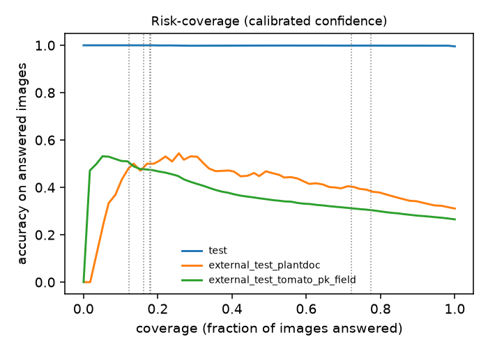

| Reliability — PlantVillage test | Reliability — PlantDoc test | Reliability — Tomato field |
|---|---|---|
| 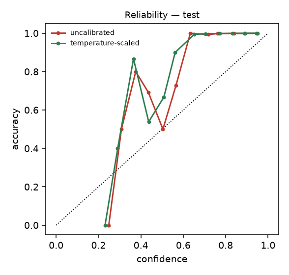 | 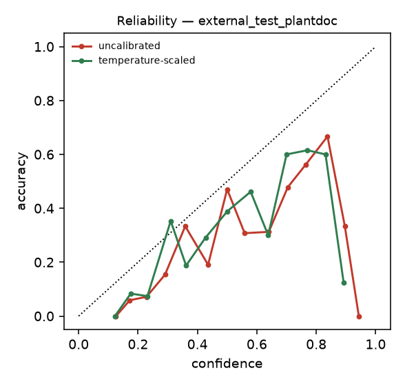 | 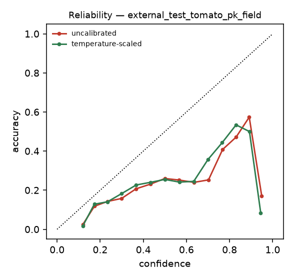 |

## 4. Confusion matrices (deployed model)

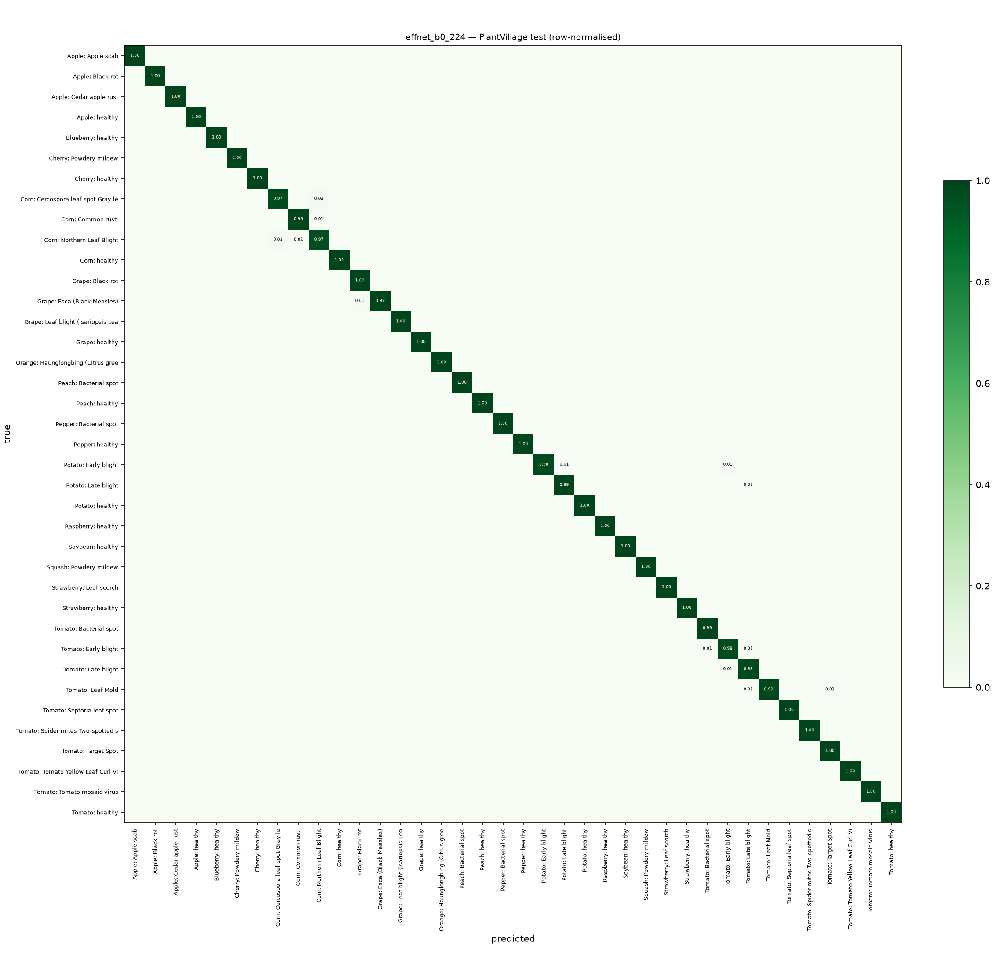

Raw counts: [`confusion_matrix_test.png`](../ml/artifacts/evaluation/effnet_b0_224/confusion_matrix_test.png). External sets (rows/cols limited to classes that occur):

| PlantDoc test | Tomato field |
|---|---|
| 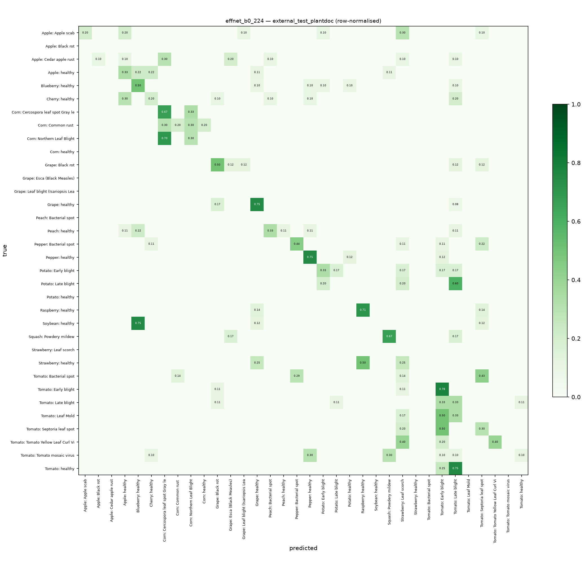 | 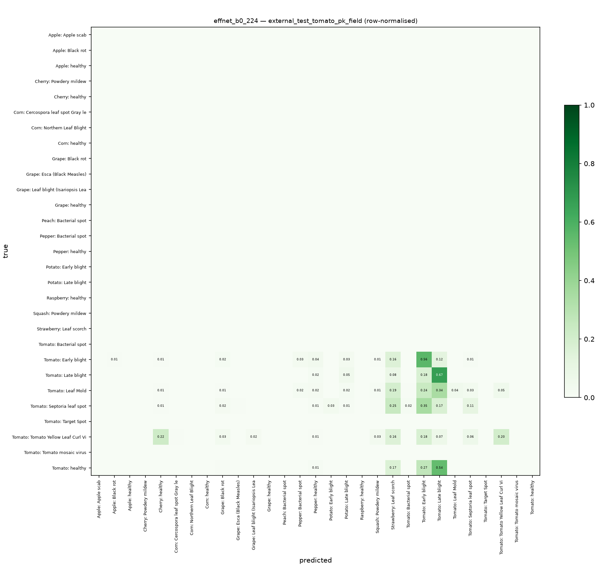 |

## 5. Per-class results (deployed model)

### PlantVillage test (internal)

| Class | Precision | Recall | F1 | Support |
|---|---:|---:|---:|---:|
| Corn — Cercospora leaf spot Gray leaf spot | 94.9% | 97.4% | 96.1% | 76 |
| Tomato — Early blight | 95.4% | 98.0% | 96.7% | 148 |
| Corn — Northern Leaf Blight | 97.9% | 96.6% | 97.3% | 147 |
| Tomato — Late blight | 98.6% | 97.9% | 98.2% | 283 |
| Potato — Early blight | 100.0% | 98.0% | 99.0% | 148 |
| Tomato — Spider mites Two-spotted spider mite | 98.4% | 99.6% | 99.0% | 248 |
| Tomato — Leaf Mold | 100.0% | 98.6% | 99.3% | 140 |
| Tomato — Target Spot | 98.6% | 100.0% | 99.3% | 210 |
| Potato — Late blight | 99.3% | 99.3% | 99.3% | 148 |
| Tomato — Bacterial spot | 99.4% | 99.4% | 99.4% | 316 |
| Grape — Black rot | 98.9% | 100.0% | 99.4% | 176 |
| Corn — Common rust | 99.4% | 99.4% | 99.4% | 178 |
| Grape — Esca (Black Measles) | 100.0% | 99.0% | 99.5% | 204 |
| Pepper (bell) — Bacterial spot | 99.3% | 100.0% | 99.7% | 147 |
| Tomato — Tomato Yellow Leaf Curl Virus | 99.9% | 99.5% | 99.7% | 801 |
| Pepper (bell) — healthy | 100.0% | 99.5% | 99.8% | 218 |
| Tomato — healthy | 99.6% | 100.0% | 99.8% | 235 |
| Tomato — Septoria leaf spot | 100.0% | 99.6% | 99.8% | 265 |
| Apple — Apple scab | 100.0% | 100.0% | 100.0% | 88 |
| Apple — Black rot | 100.0% | 100.0% | 100.0% | 91 |
| Apple — Cedar apple rust | 100.0% | 100.0% | 100.0% | 39 |
| Apple — healthy | 100.0% | 100.0% | 100.0% | 177 |
| Blueberry — healthy | 100.0% | 100.0% | 100.0% | 136 |
| Cherry — Powdery mildew | 100.0% | 100.0% | 100.0% | 150 |
| Cherry — healthy | 100.0% | 100.0% | 100.0% | 128 |
| Corn — healthy | 100.0% | 100.0% | 100.0% | 174 |
| Grape — Leaf blight (Isariopsis Leaf Spot) | 100.0% | 100.0% | 100.0% | 160 |
| Grape — healthy | 100.0% | 100.0% | 100.0% | 63 |
| Orange — Haunglongbing (Citrus greening) | 100.0% | 100.0% | 100.0% | 822 |
| Peach — Bacterial spot | 100.0% | 100.0% | 100.0% | 342 |
| Peach — healthy | 100.0% | 100.0% | 100.0% | 54 |
| Potato — healthy | 100.0% | 100.0% | 100.0% | 16 |
| Raspberry — healthy | 100.0% | 100.0% | 100.0% | 38 |
| Soybean — healthy | 100.0% | 100.0% | 100.0% | 633 |
| Squash — Powdery mildew | 100.0% | 100.0% | 100.0% | 275 |
| Strawberry — Leaf scorch | 100.0% | 100.0% | 100.0% | 162 |
| Strawberry — healthy | 100.0% | 100.0% | 100.0% | 60 |
| Tomato — Tomato mosaic virus | 100.0% | 100.0% | 100.0% | 55 |

Most frequent confusions: Tomato — Tomato Yellow Leaf Curl Virus → Tomato — Spider mites Two-spotted spider mite (4); Tomato — Late blight → Tomato — Early blight (4); Corn — Northern Leaf Blight → Corn — Cercospora leaf spot Gray leaf spot (4); Grape — Esca (Black Measles) → Grape — Black rot (2); Corn — Cercospora leaf spot Gray leaf spot → Corn — Northern Leaf Blight (2); Potato — Early blight → Tomato — Early blight (2)

Classification report: [`classification_report_test.txt`](../ml/artifacts/evaluation/effnet_b0_224/classification_report_test.txt)

### PlantDoc test (field)

| Class | Precision | Recall | F1 | Support |
|---|---:|---:|---:|---:|
| Apple — Cedar apple rust | 0.0% | 0.0% | 0.0% | 10 |
| Potato — Late blight | 0.0% | 0.0% | 0.0% | 5 |
| Soybean — healthy | 0.0% | 0.0% | 0.0% | 8 |
| Strawberry — healthy | 0.0% | 0.0% | 0.0% | 8 |
| Tomato — Bacterial spot | 0.0% | 0.0% | 0.0% | 7 |
| Tomato — Leaf Mold | 0.0% | 0.0% | 0.0% | 6 |
| Tomato — Tomato mosaic virus | 0.0% | 0.0% | 0.0% | 10 |
| Tomato — healthy | 0.0% | 0.0% | 0.0% | 8 |
| Tomato — Late blight | 12.5% | 33.3% | 18.2% | 9 |
| Peach — healthy | 100.0% | 11.1% | 20.0% | 9 |
| Corn — Cercospora leaf spot Gray leaf spot | 13.3% | 66.7% | 22.2% | 3 |
| Cherry — healthy | 33.3% | 20.0% | 25.0% | 10 |
| Tomato — Septoria leaf spot | 25.0% | 30.0% | 27.3% | 10 |
| Corn — Common rust | 66.7% | 20.0% | 30.8% | 10 |
| Apple — healthy | 30.0% | 33.3% | 31.6% | 9 |
| Apple — Apple scab | 100.0% | 20.0% | 33.3% | 10 |
| Corn — Northern Leaf Blight | 42.9% | 30.0% | 35.3% | 10 |
| Potato — Early blight | 40.0% | 33.3% | 36.4% | 6 |
| Blueberry — healthy | 33.3% | 50.0% | 40.0% | 10 |
| Tomato — Early blight | 28.0% | 77.8% | 41.2% | 9 |
| Grape — Black rot | 44.4% | 50.0% | 47.1% | 8 |
| Pepper (bell) — Bacterial spot | 66.7% | 44.4% | 53.3% | 9 |
| Squash — Powdery mildew | 50.0% | 66.7% | 57.1% | 6 |
| Tomato — Tomato Yellow Leaf Curl Virus | 100.0% | 40.0% | 57.1% | 5 |
| Pepper (bell) — healthy | 50.0% | 75.0% | 60.0% | 8 |
| Raspberry — healthy | 55.6% | 71.4% | 62.5% | 7 |
| Grape — healthy | 60.0% | 75.0% | 66.7% | 12 |

Most frequent confusions: Corn — Northern Leaf Blight → Corn — Cercospora leaf spot Gray leaf spot (7); Soybean — healthy → Blueberry — healthy (6); Tomato — healthy → Tomato — Late blight (6); Tomato — Septoria leaf spot → Tomato — Early blight (5); Strawberry — healthy → Raspberry — healthy (4); Corn — Common rust → Corn — Cercospora leaf spot Gray leaf spot (3)

Classification report: [`classification_report_external_test_plantdoc.txt`](../ml/artifacts/evaluation/effnet_b0_224/classification_report_external_test_plantdoc.txt)

### Tomato field, Pakistan (field)

| Class | Precision | Recall | F1 | Support |
|---|---:|---:|---:|---:|
| Tomato — healthy | 0.0% | 0.0% | 0.0% | 1200 |
| Tomato — Leaf Mold | 96.4% | 4.4% | 8.4% | 1200 |
| Tomato — Septoria leaf spot | 49.6% | 11.1% | 18.1% | 1200 |
| Tomato — Tomato Yellow Leaf Curl Virus | 79.0% | 20.3% | 32.3% | 1200 |
| Tomato — Early blight | 31.7% | 55.9% | 40.4% | 1200 |
| Tomato — Late blight | 35.0% | 67.2% | 46.0% | 1200 |

Most frequent confusions: Tomato — healthy → Tomato — Late blight (645); Tomato — Septoria leaf spot → Tomato — Early blight (418); Tomato — Leaf Mold → Tomato — Late blight (414); Tomato — healthy → Tomato — Early blight (320); Tomato — Septoria leaf spot → Strawberry — Leaf scorch (295); Tomato — Leaf Mold → Tomato — Early blight (287)

Classification report: [`classification_report_external_test_tomato_pk_field.txt`](../ml/artifacts/evaluation/effnet_b0_224/classification_report_external_test_tomato_pk_field.txt)

## 6. Error analysis

The most confident mistakes of the deployed model (real images):

| PlantVillage test | PlantDoc test | Tomato field |
|---|---|---|
| 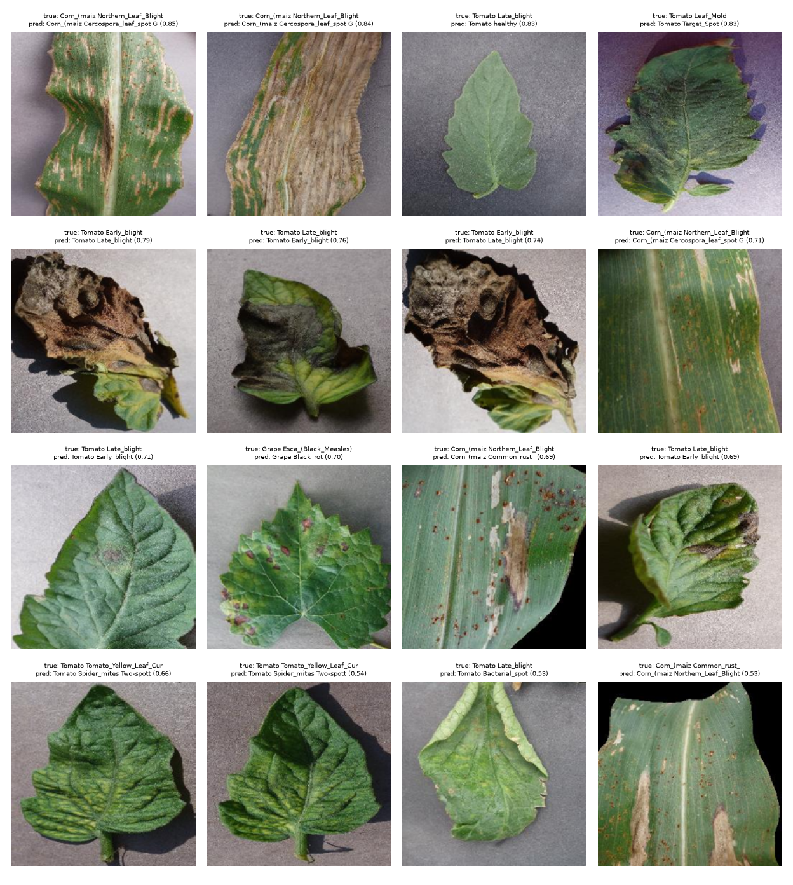 | 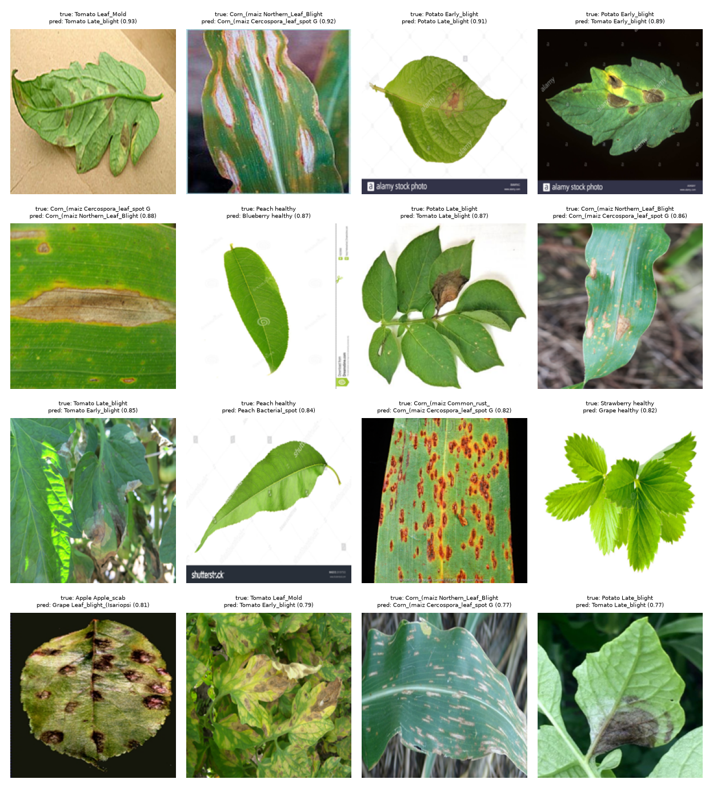 | 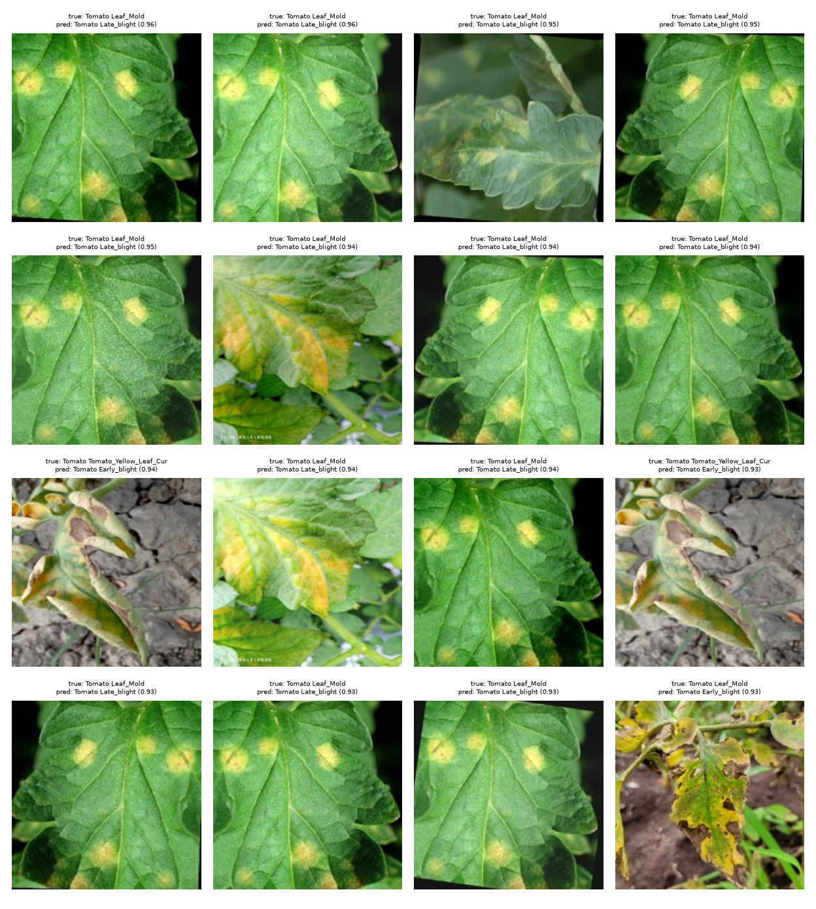 |

<!-- ANALYSIS:START -->
**Internal test (34 errors in 7,751 images).** Mistakes are between visually similar lesion types on the same crop:
Tomato Yellow Leaf Curl Virus → Spider mites (4), Tomato Late blight → Early blight (4), Corn Northern Leaf Blight ↔
Cercospora/Gray leaf spot (4 + 2), Grape Esca → Black rot (2). The lowest per-class F1 (Corn Cercospora 0.961,
Tomato Early blight 0.967, Corn Northern Leaf Blight 0.973) are exactly these confusable pairs. No class collapses.

**PlantDoc (field, 222 images).** Errors are dominated by background and context: healthy leaves photographed on the
plant are predicted as other crops' healthy classes (Blueberry/Raspberry) or as Late blight; Septoria leaf spot is
read as Early blight; Apple Cedar rust, Potato Late blight and Soybean healthy get F1 = 0 (n = 10, 5, 8).
Crop-level accuracy is 58%, i.e. the model often cannot even identify the crop on cluttered photos.

**Tomato field set (7,200 images).** The model systematically calls healthy field tomato leaves *Late blight* (645)
or *Early blight* (320) — healthy F1 = 0.0 — and confuses Septoria with Early blight (418) and Leaf Mold with Late
blight (414). Natural lighting, shadows, soil and multiple leaves look like lesions to a model that only ever saw
single leaves on grey paper.

**Takeaway.** The model is excellent on PlantVillage-style photos and unreliable on field photos — the classic
dataset-bias result reported in the PlantDoc paper. The deployed app mitigates this by (1) marking ~70% of field
photos as *not recognised* and (2) withholding treatment advice below the confidence threshold; on field photos the
answers it does give confidently are still only ~50% correct, which the UI and documentation state explicitly.
Training on labelled field images (e.g. PlantDoc-train) is the most effective next step.
<!-- ANALYSIS:END -->

## 7. Explainability

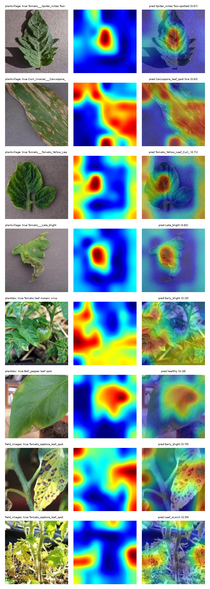

Grad-CAM of the deployed model on PlantVillage test images (top rows) and field images (bottom rows), computed with the same code path the API uses. Heat-maps indicate influence on the class score, not correctness.

## 8. Latency and size

| Model | CPU batch-1 mean / p50 / p95 (ms) | MPS batch-1 mean (ms) | Parameters | Checkpoint |
|---|---|---:|---:|---:|
| EfficientNet-B0 | 132.9 / 135.5 / 149.9 | 8.5 | 4.1 M | 16 MB |

Measured on the Apple M1 development machine (8 GB, other applications running), 40 timed runs after 5 warm-up runs.
