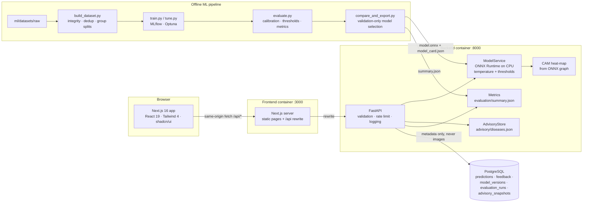

# Project Architecture

## System overview



## Repository layout

```
krishiguard-ai/
├── frontend/                 Next.js app (pages: / /detect /results /diseases /performance /methodology /about)
│   ├── src/app/              routes (all statically prerendered; data fetched client-side)
│   ├── src/components/       site chrome, advisory renderer, Grad-CAM viewer, feedback, shadcn/ui
│   ├── src/lib/              typed API client, i18n (en/hi), report builder, session result store
│   ├── src/__tests__/        Vitest component tests
│   └── e2e/                  Playwright journey tests (desktop + mobile)
├── backend/
│   ├── app/api/              routes + Pydantic schemas
│   ├── app/core/             settings (KG_*), JSON logging, errors, rate limiter
│   ├── app/ml/               inference (validation, preprocessing, calibrated prediction), Grad-CAM
│   ├── app/services/         advisory store, metrics loader
│   ├── app/db/               SQLAlchemy models + fail-soft session
│   └── tests/                pytest: preprocessing, model, API, real-model integration
├── ml/
│   ├── datasets/{raw,processed,metadata}
│   ├── preprocessing/        build_dataset.py
│   ├── training/             common.py, train.py, tune.py, run_experiments.py
│   ├── evaluation/           evaluate.py, compare_and_export.py
│   ├── experiments/          MLflow (sqlite), Optuna db, logs, benchmarks
│   └── artifacts/            eda/, models/, evaluation/, serving/
├── advisory/                 diseases.json (38 entries, en/hi, cited) + SOURCES.md
├── scripts/                  verify_datasets.py, sync_figures.sh, benchmark_hw.py, profile_steps.py
├── docs/                     reports and guides
├── docker-compose.yml, .env.example, .dockerignore
```

## Key design decisions

| Decision | Rationale |
|---|---|
| Group-level splitting (leaf id ∪ MD5 ∪ pHash) | Prevents the well-known PlantVillage leakage that inflates accuracy |
| External validation set from PlantDoc-train | Lets temperature, thresholds and model choice see field-like data without touching any test set |
| Temperature scaling + two thresholds | Converts over-confident softmax into a calibrated score; withholds advice when uncertain |
| Advice only for *confident* results | Reduces harm from acting on a wrong diagnosis |
| Advisory as versioned JSON, separate from the model | Content can be reviewed/updated by agronomists without retraining; snapshots stored in DB |
| Same-origin `/api` rewrite in Next.js | No CORS in production, backend not exposed publicly in compose |
| Fail-soft database | Diagnosis keeps working if Postgres is down; persistence endpoints return 503 |
| Images never stored | Privacy; only SHA-256 + metadata recorded |
| CPU inference with ONNX Runtime | No PyTorch at serving time: ~150 MB deployment that fits serverless (Vercel), ~35 ms per image |
| Serving checkpoint integrity | `model_card.json` carries the SHA-256 of `model.pt`; the API refuses to load on mismatch |
| Preprocessing parity test | Serving preprocessing is unit-tested to equal the training eval transform |

## Request flow: `POST /api/predict`

1. slowapi rate limit → read ≤ max+1 bytes → reject oversize (413).
2. Declared MIME checked, then **content sniffed** with Pillow (`verify` + decode); EXIF orientation applied; minimum side checked.
3. Sharpness = variance of Laplacian on a 256×256 grayscale copy → `blurry` flag below the validation-derived threshold.
4. Model view = resize + centre crop (identical to evaluation) → logits → softmax(logits / T).
5. Status: `confident` (p ≥ τ, and not blurry) / `uncertain` (τ_r ≤ p < τ or blurry) / `unrecognized` (p < τ_r).
6. CAM for the predicted class (computed inside the ONNX graph; equal to Grad-CAM for this architecture), returned as base64 PNGs of model input, heatmap, overlay.
7. Advisory attached only when `confident`; prediction metadata persisted (fail-soft); structured log line emitted.
